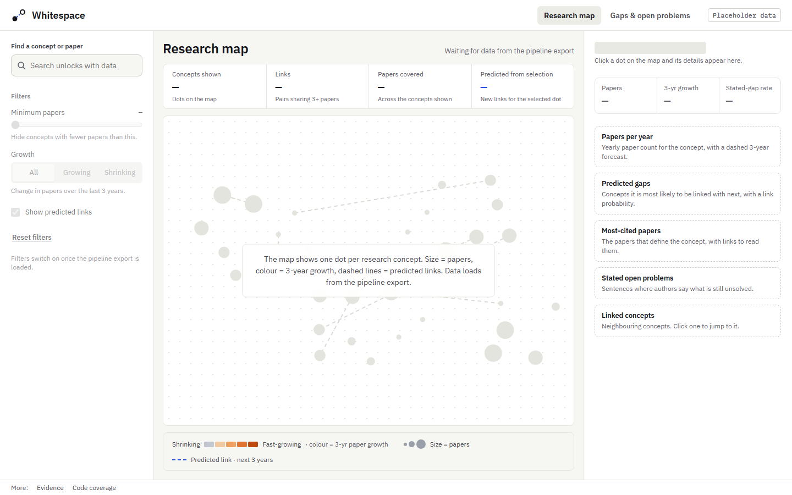
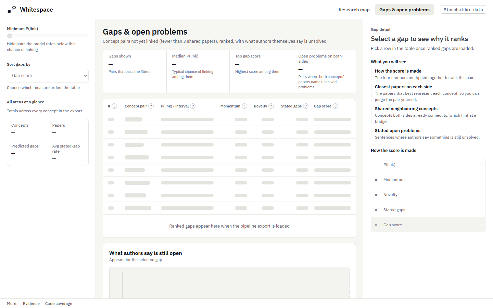
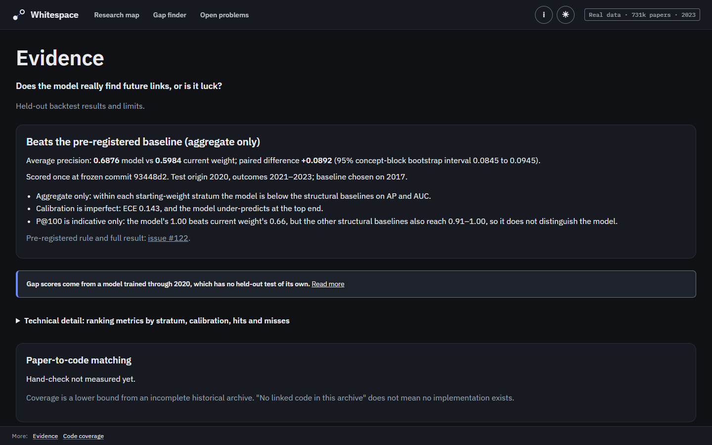
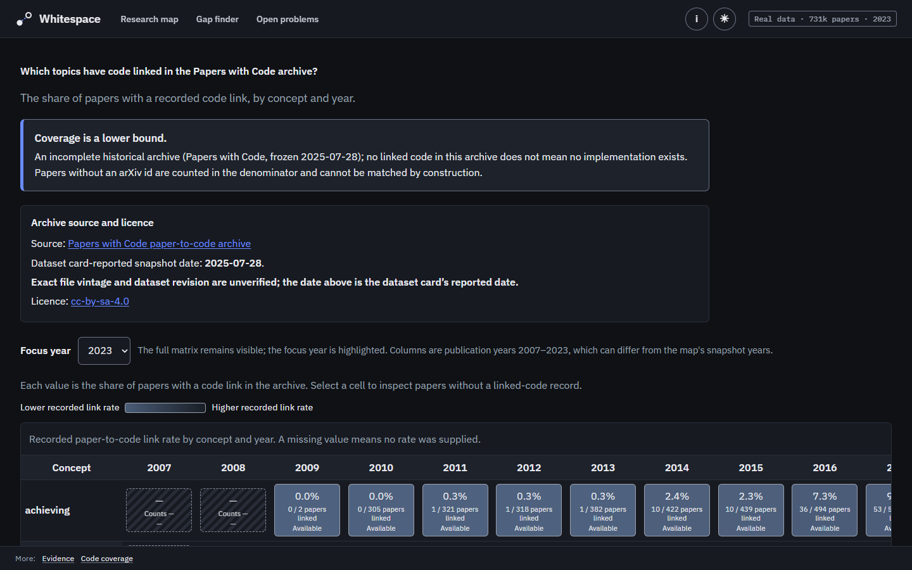

# Whitespace

[](https://whitespace-hacktheburgh-26.vercel.app)
[](https://github.com/PersiaF04/HACKTHEBURGH-26/actions/workflows/ci.yml)
[](https://github.com/PersiaF04/HACKTHEBURGH-26/actions/workflows/whitespace.yml)
[](https://github.com/PersiaF04/HACKTHEBURGH-26/actions/workflows/deploy.yml)


**See where AI research is going, and the questions nobody has answered yet.**

**Live site: [whitespace-hacktheburgh-26.vercel.app](https://whitespace-hacktheburgh-26.vercel.app)** (placeholder data until the real export lands)

Whitespace is a research-discovery tool for AI research. It builds a concept graph from OpenAlex works whose primary subfield is Artificial Intelligence (subfield 1702), 2010-2023, follows how it changes year by year, and ranks the concept pairs that aren't linked yet by how likely they are to become linked within three years. Alongside the forecast it shows where published work has no linked code in the Papers with Code archive. Mining the open problems authors state is planned, not built.

Built at HackTheBurgh XIII for the HRT and G-Research tracks.

> **Status:** the real run has been scored once (2020 test year, see [#122](https://github.com/PersiaF04/HACKTHEBURGH-26/issues/122)), but the export is not merged yet, so the site still shows placeholder data, labelled as such on every page. The forecast is evaluated once on a held-out test year, and the result is published whichever way it falls.



## Who it's for

| User | Need |
| --- | --- |
| PhD and MSc students | Choose a novel, timely thesis topic |
| Researchers | Spot emerging directions and avoid saturated ones |
| Lab leads and supervisors | Decide which directions to pursue or recommend |

## What it does

- **Explore:** a research map of the latest snapshot year. Concepts are sized by paper count and coloured by growth. Open a concept to see its trend, predicted gaps and top papers. Search and the open-problems view are placeholders for now.
- **Gaps:** unlinked concept pairs ranked by the Platt-scaled link probability (calibration is imperfect: see Evidence) that they link within three years, with score components and supporting papers.
- **Evidence** (at `/evidence`): the backtest. Average precision, precision@k, calibration and base rate against every declared baseline, plus hits and misses.
- **Code coverage** (at `/coverage`): a concept × year heatmap of how many papers have code linked in the Papers with Code archive. Click a cell to list the papers without a link.

### Screens

These screenshots of the live site show placeholder data; they will be replaced once the real export is live.

| Gaps and open problems | Evidence | Code coverage |
| --- | --- | --- |
|  |  |  |

## The two tracks

The track framings below are the team's own wording; the official prompts aren't confirmed.

- **HRT track: which research gap to pursue.** The probabilities come from a purged temporal backtest: the model is fit on origins through 2014, calibrated on 2017 and tested once on 2020, with outcomes in 2021–2023, so no outcome window leaks into a later split. The pre-registered headline is the model's average precision minus the best baseline's (the baseline is chosen on 2017, never on the test year), with a 95% bootstrap interval. The verdict is "beats the baseline" only if the whole interval is above zero.
- **G-Research track: making the invisible visible.** The map shows where research is moving, and the coverage view shows where published work has no linked code. Mining limitations and future work from abstracts is planned.

## How it works

1. **Ingest:** OpenAlex works in AI (subfield 1702), downloaded in checkpointed windows with a manifest.
2. **Concepts:** phrases extracted per snapshot year, so a year never uses vocabulary from the future.
3. **Graph:** two concepts are linked once they co-occur in at least three papers.
4. **Model:** pair features from each snapshot and a link model, calibrated on a separate origin.
5. **Evaluation:** a purged backtest on every eligible pair, not sampled negatives, against declared baselines.
6. **Code coverage:** papers joined locally to the Papers with Code archive, with no API calls.
7. **Export:** static JSON files for the site, with placeholder and synthetic flags, a route map and a validator.

The site is a static app: every result is precomputed, so the demo makes no live external calls while it's being judged.

## Tech stack

- **Pipeline:** Python 3.11, with offline tests.
- **Frontend:** Vite, React, TypeScript, IBM Plex.
- **Hosting:** Vercel, deployed automatically from `main` by GitHub Actions.

## Repository layout

| Path | Contents |
| --- | --- |
| `whitespace/pipeline/` | Ingest, concepts, graphs, labels, baselines, model, backtest, metrics, code layer and exporters |
| `whitespace/tests/` | Offline tests, plus a labelled synthetic sample export |
| `whitespace/web/` | Frontend; exported data goes in `public/data/` |
| `docs/` | Demo script, judge Q&A, submission checklist, team coordination |
| `docs/BACKLOG.md` | Deferred and removed items (not built) |
| `.github/workflows/` | CI (Markdown lint, web build, pipeline tests) and the production deploy |
| `PRD.md` | Product requirements and evaluation protocol |

## Run locally

Pipeline tests, from the repository root:

```sh
python -m pip install -r whitespace/requirements.txt
python -m pytest -q whitespace
```

Frontend, with Node.js 22:

```sh
npm --prefix whitespace/web ci
npm --prefix whitespace/web run dev      # development server
npm --prefix whitespace/web run build    # type-check and build
```

With no files in `whitespace/web/public/data/`, the frontend uses its bundled placeholder fixtures. Copy an export there to see it rendered.

## Deployment

Every merge to `main` that changes `whitespace/web/` deploys production through [`.github/workflows/deploy.yml`](.github/workflows/deploy.yml). The job runs only on `main`, uses a Vercel token held in the protected `production` environment, and never runs on pull requests. You can also start it from *Actions → Deploy production → Run workflow*. Deep links work because `whitespace/web/vercel.json` rewrites every route to the app.

## Data and limitations

- **Papers:** [OpenAlex](https://openalex.org) metadata (CC0). Raw abstracts aren't committed or published.
- **Code links:** the [Papers with Code archive](https://huggingface.co/datasets/pwc-archive/links-between-paper-and-code) (CC BY-SA 4.0, snapshot of 28 July 2025). Coverage is a lower bound: a paper without a link has no code in that archive, not necessarily no code at all. Papers after mid-2025 will look unlinked.
- **Links:** a "link" means co-occurrence in at least three papers. It measures attention, not importance or truth.
- **Prior art:** forecasting concept pairs isn't new; see, for example, Krenn et al., [arXiv:2210.00881](https://arxiv.org/abs/2210.00881). ERLA (IC Hack 26) is a related project; this is based only on its Devpost entry and repository, not on a detailed comparison. Whitespace's contribution is the purged out-of-sample evaluation (residual: topic assignments are a post-October-2026 snapshot) and turning the forecast into a decision tool.

## Team

- **Persia** ([@PersiaF04](https://github.com/PersiaF04)): product owner.
- **Varshil:** frontend and design.
- **sanamorii:** pipeline, model and evaluation.

The team builds with AI coding agents: Claude Code agents implement issues and Codex agents review pull requests, under the team's decisions on scope and merging. See [`AGENTS.md`](AGENTS.md) and [`TEAMWORK.md`](TEAMWORK.md) for how work is organised.

## Licence

The code is released under the [MIT License](LICENSE).

The data sources keep their own licences, which the MIT licence does not cover: OpenAlex metadata is CC0, and the coverage data derived from the Papers with Code archive is CC BY-SA 4.0.
