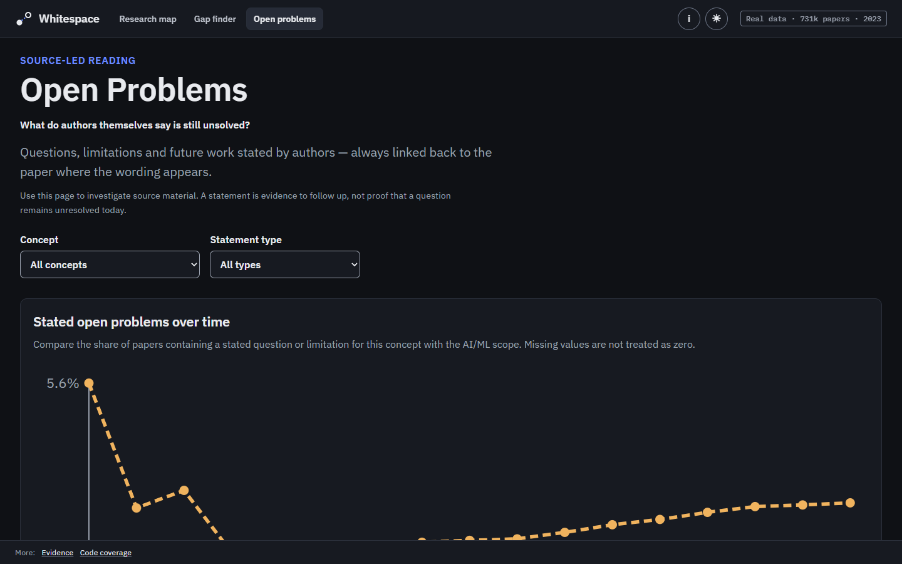

<h1 align="center">Whitespace</h1>

<p align="center">See where AI research is going, and the questions nobody has answered yet.</p>

<p align="center"><a href="https://whitespace-hacktheburgh-26.vercel.app">Explore the live site</a></p>

<p align="center">
  <a href="https://github.com/PersiaF04/HACKTHEBURGH-26/actions/workflows/ci.yml"></a>
  <a href="https://github.com/PersiaF04/HACKTHEBURGH-26/actions/workflows/whitespace.yml"></a>
  <a href="https://github.com/PersiaF04/HACKTHEBURGH-26/actions/workflows/deploy.yml"></a>
  
</p>

Whitespace is a research-discovery tool for AI literature. It turns OpenAlex works whose primary subfield is Artificial Intelligence (subfield 1702) into a changing concept graph, then ranks unlinked concept pairs by their likelihood of co-occurring within three years. On the live site these likelihoods come from a production model with no held-out test of its own, so read them as a ranking, not as chances. It also shows where papers have linked code in the Papers with Code archive.

Built at HackTheBurgh XIII for the HRT and G-Research tracks.


*Research map on the live site, real data: a single 2023 map and gap snapshot of 730,671 OpenAlex works (840 records dated 2024–2026 are excluded). Gap scores come from the through-2020 production model, which has no held-out test of its own. The held-out result below describes the frozen backtest model; 2021–2023 are its outcome years, not map snapshots.*

**Contents:** [Problem](#the-problem) · [What it does](#what-it-does) · [Results](#results) · [How it works](#how-it-works) · [Tracks](#tracks) · [Tech stack](#tech-stack) · [Run locally](#run-locally) · [Deployment](#deployment) · [Data and limitations](#data-and-limitations) · [Team](#team) · [Licence](#licence)

## The problem

Research moves faster than people can read it. Search finds work that already exists, but does not rank combinations that have not yet become connected in published literature. Authors' open problems are scattered across papers, and paper-to-code links are incomplete and difficult to compare.

## What it does

- **Research map:** explore the latest snapshot as a 3D graph. Branch hubs are clusters found in the map layout and named for the words their concepts share; they are derived in the app, not exported by the pipeline. Each branch links to its largest concepts, coloured from red for the biggest to blue for the smallest. An option draws the top-ranked gaps as bridges between the two concepts they join. Selecting a branch, concept or gap opens its details; a concept shows its papers per year, its growth and the gaps it appears in. The summary counts distinct papers in the corpus. The map has no time slider.
- **Gap finder:** review unlinked concept pairs, their scores and supporting papers. Momentum counts only when both concepts are growing, and summary stats count only concepts with positive growth. A list of 534 generic filler phrases (for example "vice versa" or non-English function words) is hidden from this list only, and no concept appears in more than three listed gaps; the vocabulary, model and backtest are unchanged. A stated-gaps column shows how often papers on each side state an open problem; it is context only and does not change the gap score or rank. Likelihoods come from the production model, which has no held-out test of its own, so they are rankings, not chances. Paper-title search is unavailable; the search box filters concept names only.
- **Open problems:** read 911 short open-problem excerpts quoted from abstracts indexed by OpenAlex. Each is attributed and linked to its source paper, and copyright remains with the publishers and authors. They are for display only. A pattern filter selected them. On open-problem statements, AI-labelled precision is 24/34 (71%), not human-validated, and the labels come from the same AI system that built the extractor, so they are not independent ([issue #270](https://github.com/PersiaF04/HACKTHEBURGH-26/issues/270)). Future-work and limitation statements measured worse and are not shown. Filter by concept, and compare the stated-problem rate over time with the wider AI scope.
- **Evidence:** at [`/evidence`](https://whitespace-hacktheburgh-26.vercel.app/evidence), a headline card states the pre-registered verdict (aggregate only) with its caveats and a link to issue #122. A technical-detail section holds ranking tables comparing each method's P@100, AP and ROC AUC against the base rate, calibration, and hits and misses. The paper-to-code hand-check is shown as not yet measured.
- **Code coverage:** explore the concept-by-year archive coverage and papers without a linked record at [`/coverage`](https://whitespace-hacktheburgh-26.vercel.app/coverage). Coverage uses publication years, so its range can differ from the map's snapshot years.

The header navigation has three tabs: Research map, Gap finder and Open problems. Evidence and Code coverage are available through footer links and the direct URLs above. The header badge shows the data source and the snapshot year range.

<p align="center">
  
  
  
  
</p>

*Gap finder, Open problems, Evidence and Code coverage on the live site, real data (2023 snapshot). The gap list is a production forecast whose outcomes are not yet observed; read its likelihoods as a ranking, not as calibrated chances.*

## Results

The real backtest was scored once at the 2020 test origin (outcomes 2021–2023) on frozen commit `93448d2`. The aggregate result below is the pre-registered comparison against the baseline selected on the 2017 calibration origin; it does not mean the model beats the stronger structural baselines within strata. See [issue #122](https://github.com/PersiaF04/HACKTHEBURGH-26/issues/122) for the result and its review correction.

| Measure | Result |
| --- | --- |
| Average precision (all strata; 3,943,852 eligible pairs, 1,108,392 positives; base rate 0.281) | Model 0.6876; `current_weight` baseline 0.5984; difference +0.0892 (95% concept-block bootstrap interval [0.0845, 0.0945]) |
| Precision@100 | Model 1.00; baseline 0.66; difference +0.34 (wide interval [0.11, 0.62]); indicative only, since other baselines reach 0.91–1.00 |
| ROC AUC (all strata) | Model 0.867; baseline 0.818 |
| Calibration | Imperfect: ECE 0.143, Brier skill 0.186; top-decile prediction 0.53 versus 0.78 observed |
| Papers with linked code in the archive | 43,581 of 731,511 works (5.96%); only 139,613 have an arXiv ID, so this archive-based rate is a lower bound |

The aggregate AP gain is partly driven by the strata mix: within each starting-weight stratum, the model is below the five structural baselines (common neighbours, Adamic–Adar, Jaccard, degree product and preferential attachment) on AP and AUC. The baseline is near chance within strata (AUC about 0.50). P@100 is not distinctive. Concept vocabulary uses deterministic phrases without embeddings; concept quality is unmeasured. The Papers with Code 100-row hand-check frame is unlabelled, so no hand-check result is reported.

## How it works

1. **Ingest:** collect OpenAlex works in AI (subfield 1702) and keep a checkpointed manifest.
2. **Build concepts:** extract phrases per snapshot year, without using later vocabulary.
3. **Build the graph:** link two concepts when they co-occur in at least three papers.
4. **Rank gaps:** score eligible pairs from snapshot features and a link model.
5. **Evaluate:** score the full eligible pair population in a purged temporal backtest against declared baselines.
6. **Measure code coverage:** join papers locally to the Papers with Code archive; no API calls are made by the site.
7. **Export:** write static JSON artifacts with route, placeholder and synthetic-data flags, then validate them.

The site is a static app. Results are precomputed, so the demo makes no live external calls.

## Tracks

These are the team's framings; the official prompts have not been confirmed.

- **HRT:** help researchers decide which research gap to pursue, with the backtest and its limitations visible.
- **G-Research:** make research directions and recorded code coverage easier to see. The archive view indicates linked code, not whether code exists elsewhere.

## Tech stack

- **Pipeline:** Python 3.11
- **Frontend:** Vite, React, TypeScript and IBM Plex
- **Hosting:** Vercel, deployed from `main` by GitHub Actions

## Run locally

From the repository root, install the pipeline requirements and run its offline tests:

```sh
python -m pip install -r whitespace/requirements.txt
python -m pytest -q whitespace
```

With Node.js 22, install and run the frontend:

```sh
npm --prefix whitespace/web ci
npm --prefix whitespace/web run dev
```

To type-check and build it:

```sh
npm --prefix whitespace/web run build
```

The real export is committed in `whitespace/web/public/data/`, so the dev server shows real data. Without those files, the frontend falls back to bundled, labelled placeholder fixtures.

## Deployment

Changes to `whitespace/web/` merged to `main` deploy production through [`.github/workflows/deploy.yml`](.github/workflows/deploy.yml). The job runs only on `main`, uses a Vercel token in the protected `production` environment, and does not run on pull requests. It can also be started from *Actions → Deploy production → Run workflow*. Deep links work because `whitespace/web/vercel.json` rewrites routes to the app.

## Data and limitations

- **Papers:** [OpenAlex](https://openalex.org) metadata (CC0). Raw abstracts are not committed or published. The live export ends in 2023: the map and gaps use a single 2023 snapshot, and the 840 records dated 2024–2026 are excluded because those years are too thin. The topic filter uses OpenAlex topic assignments made after October 2026, so they are not as known at each historical origin.
- **Code links:** the [Papers with Code archive](https://huggingface.co/datasets/pwc-archive/links-between-paper-and-code), CC BY-SA 4.0, snapshot of 28 July 2025. Coverage is a lower bound: a missing link means the archive has no link, not that no code exists. Papers after mid-2025 will look unlinked. The linked-code figure in Results (43,581 of 731,511) is the join over the full 731,511-work corpus, including the 840 records dated 2024–2026 that the live map excludes. The 100-row hand-check frame remains unlabelled; join precision and archive recall are not established.
- **Link definition:** a link means co-occurrence in at least three papers. This measures attention, not importance or truth.
- **Forecast:** the held-out result comes from one 2020 test origin. The production forecast has no held-out test of its own; the published aggregate comparison is against `current_weight`, selected on 2017. Within each starting-weight stratum the model is below the five structural baselines on AP and AUC.
- **Prior art:** forecasting concept pairs is not new; see Krenn et al., [arXiv:2210.00881](https://arxiv.org/abs/2210.00881). ERLA (IC Hack 26) is related. This comparison is based only on its [Devpost entry](https://devpost.com/software/magi-2bhmze) and [repository](https://github.com/e24z/ic_hack_26), not a detailed comparison. Whitespace's contribution is the purged out-of-sample evaluation (with the residual that topic assignments are a post-October-2026 snapshot) and turning the forecast into a decision tool.

## Team

- **Persia** ([@PersiaF04](https://github.com/PersiaF04)): product owner
- **Varshil:** frontend and design
- **sanamorii:** pipeline, model and evaluation

The team builds with AI coding agents: Claude Code agents implement issues and Codex agents review pull requests, under the team's decisions on scope and merging. See [`AGENTS.md`](AGENTS.md) and [`TEAMWORK.md`](TEAMWORK.md) for how work is organised.

## Licence

The code is released under the [MIT License](LICENSE). Data sources keep their own licences, which the MIT licence does not cover: OpenAlex metadata is CC0, and coverage data derived from the Papers with Code archive is CC BY-SA 4.0.
